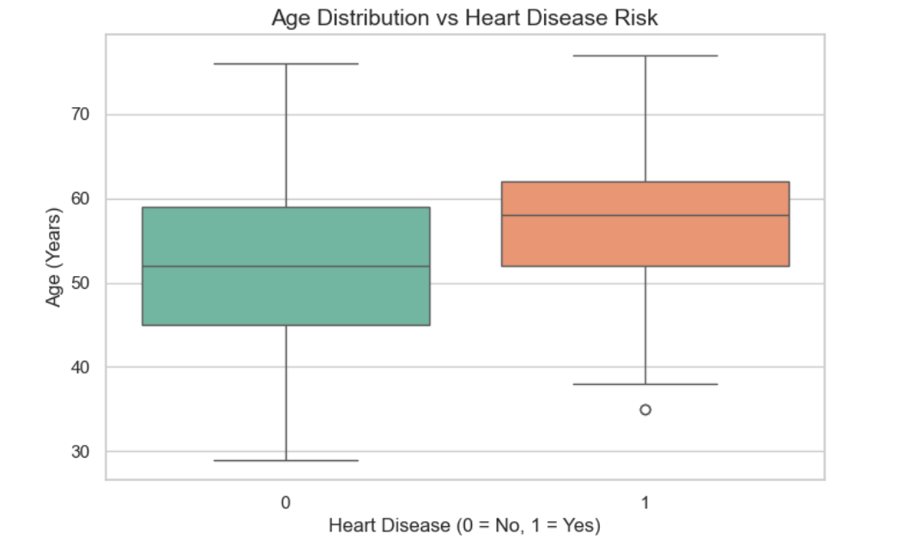
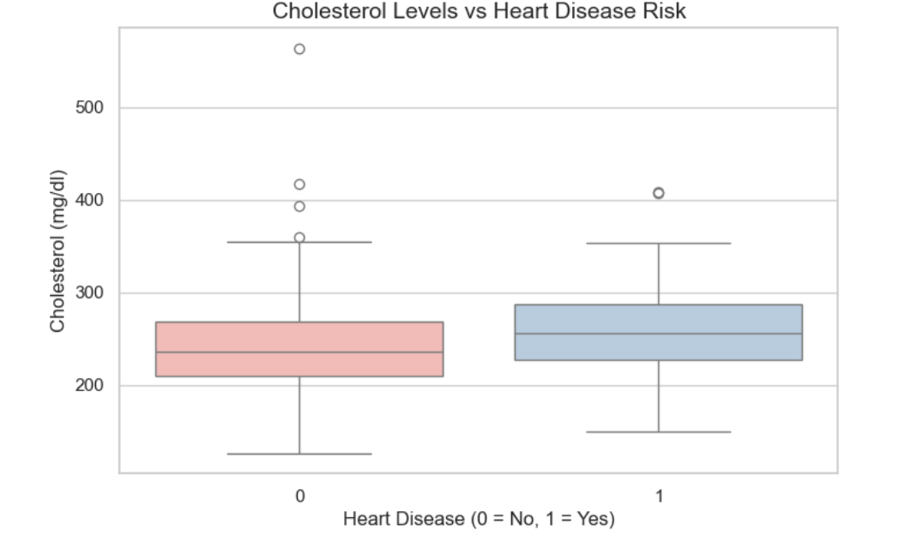
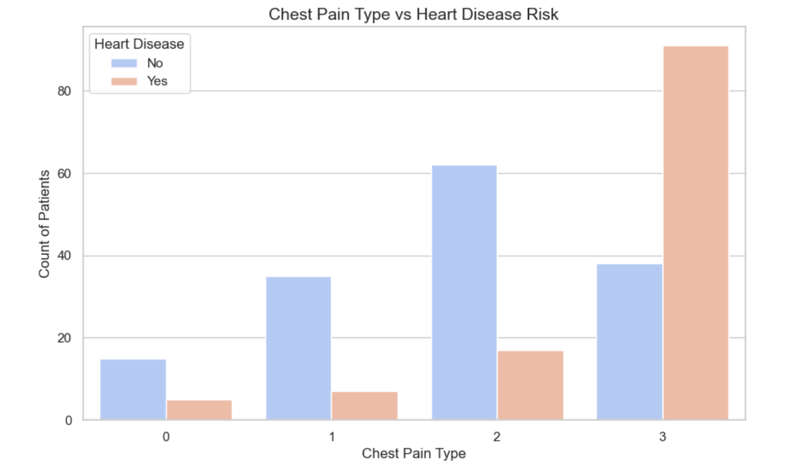

# Statlog Heart Disease Exploratory Data Analysis

A data analysis project analyzing clinical attributes and their relationship with heart disease risk using Python and Seaborn.

## Project overview
The main goal of this project is to perform clean data preparation and describe analytics on the **Statlog(Heart Disease)** dataset.
The analysis focuses on standardizing medical features into more readable labels and visualizing some of the key points of this dataset. 

## Dataset information
- **Source:** Kaggle (Statlog Heart Disease Dataset)
- **Size:** 270 patient records, 14 attributes
- **Key variables analyzed:** 'age': Patient age in Years -'sex':Gender ('male'/'female') -'cholesterol': Serum cholesterol in mg/dl- - 'heart_disease' : Target variable indicating the presence ('1'/'yes') or absence ('0'/'no') of heart disease.

## Tech stack and dependencies
- **Python**
- **Pandas** for cleaning data and transforming
- **Matplotlib and Seaborn** for visualisation
- **Kagglehub** for the dataset retrieval

## Key visualisations and analytical findings

### 1. Age distribution vs heart disease risk
* **Insight:** Boxplot analysis shows that patients diagnosed with heart disease have a higher median age (~58 years) compared to healthy individuals. Age exhibits a clear positive trend with heart diseases.
* **Outlier note:** A notable outlier exists, a patient around 35 years old diagnosed with heart disease, illustrating that while age increases this risk, early onset can occur.

### 2. Cholesterol levels vs heart disease risk
* **Insight:** Comparing cholesterol levels across both groups reveals similar median values. This indicates that a high cholesterol level alone is not a binary indicator in this cohort.
* **Outlier note:** An extreme outlier (>550 mg/dl) is present in the non-disease group, showing medical data variability where high cholesterol does not automatically indicate an active diagnosis.
  

### 3. Chest pain type vs. heart disease risk
* **Insight:** Countplot distribution demonstrates a significantly stronger correlation between specific chest pain categories and heart disease diagnosis compared to general numeric values like cholesterol. Asymptomatic cases and specific pain types show distinct distribution peaks in affected patients.

